<p align="center">
  <a href="https://alibi.eliohaddad.workers.dev/"><b>Live demo: alibi.eliohaddad.workers.dev</b></a>
  &nbsp;·&nbsp;
  <a href="https://youtu.be/CPnbEoRS-OY">Watch the demo video</a>
</p>

<p align="center">
  <a href="https://alibi.eliohaddad.workers.dev/">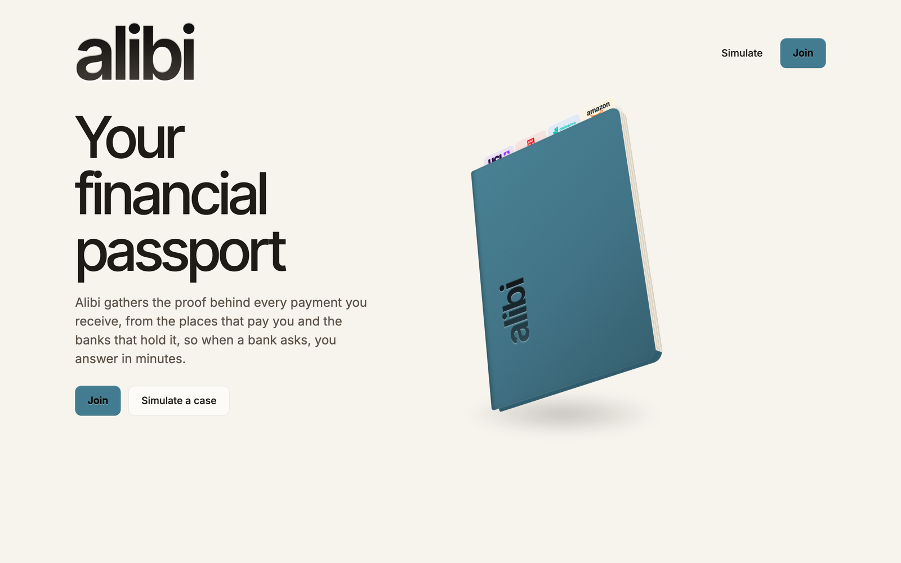</a>
</p>

<h3 align="center">Your money’s alibi, ready before anyone asks.</h3>

**alibi** is a financial passport that the account holder controls. It links what lands in your bank to the sales, refunds, fees and payouts that explain it, and keeps that evidence ready in the background. When a bank asks about a payment, you answer in minutes with evidence the bank can check, and you share only what the question needs.

<p align="center">
  <a href="https://youtu.be/CPnbEoRS-OY"></a>
  <br>
  <sub>Demo video, narrated by Hugo. Click to play on YouTube.</sub>
</p>

Built in one night for **AgentVerse 2026, Finance Track**. Every person, account, merchant and bank in this repo is synthetic, and both connections are simulated services.

---

## One credit, one restricted account

**Maya** is a student who resells clothes. Her bank has restricted her account and asks her to explain one credit of **£2,160**, and rent is due soon.

Her sales were £2,400, she refunded £180 and paid £60 in fees, so the numbers add up. But the marketplace’s message only says the money was *released to her seller balance*, which is not proof that it reached her bank. **Matching amounts are not evidence.**

Today she has two bad options: send screenshots that prove nothing, or hand over her whole financial life. alibi gives her a third. The evidence was already gathered before the bank asked, the answer is checked in code, and Maya approves exactly what leaves, one named bank at a time. The bank analyst still makes their own decision.

| What Maya needs | What alibi does |
| --- | --- |
| Proof that exists **before** anyone asks | Signed merchant records and bank rows arrive in the background, are matched, and are kept with their versions. alibi flags the unexplained credit before any bank asks. |
| An answer the bank can **check** | Gemini investigates; code recomputes every penny, checks settlement timing and references, and labels each claim *supported*, *contradicted* or *unresolved*. |
| To share **only** what the question needs | Maya sees exactly what the bank would receive and what stays private, and approves that exact package for one named bank. |
| Not to start over **next time** | A second bank’s different question is answered from the same passport, with a new package and a fresh approval. Neither bank can see the other’s. |

---

## How alibi works

<sub>These illustrations come from the product’s landing page. The demo itself runs on synthetic case 1 (Mock Marketplace, Bank A and Bank B).</sub>

<table>
  <tr>
    <td width="50%" valign="top">
      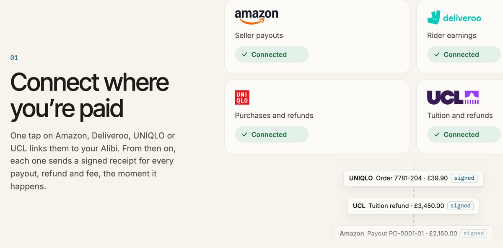
      <b>1 · Connect where you’re paid.</b> One tap links a marketplace or employer. From then on, each one sends a signed record for every payout, refund and fee.
    </td>
    <td width="50%" valign="top">
      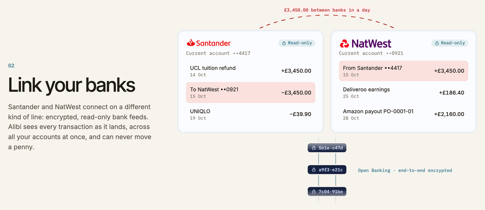
      <b>2 · Link your banks.</b> Banks connect on a separate, encrypted, read-only line. alibi can see every transaction and can never move a penny.
    </td>
  </tr>
  <tr>
    <td valign="top">
      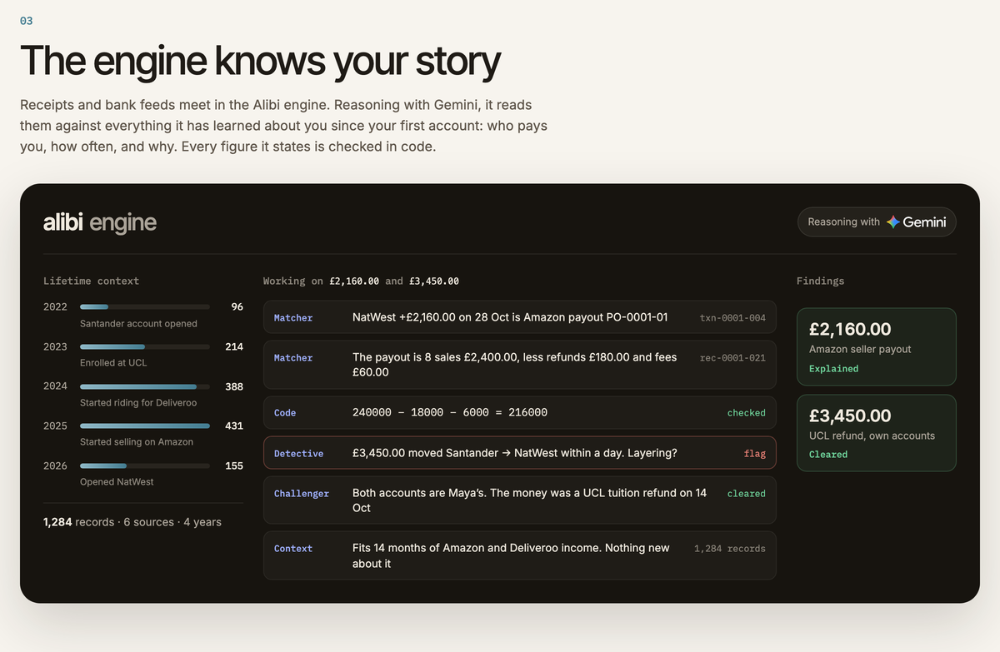
      <b>3 · The engine knows your story.</b> Gemini reads receipts and bank rows together. Every figure it states is checked in code.
    </td>
    <td valign="top">
      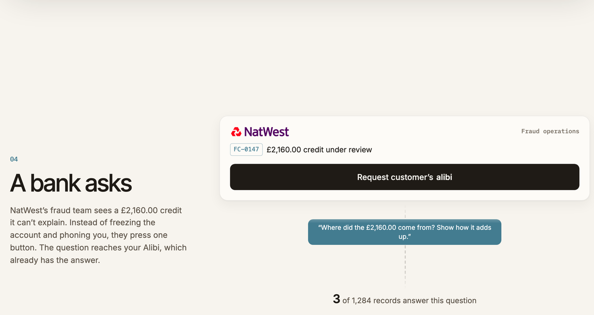
      <b>4 · A bank asks.</b> The bank presses one button, “Request customer’s alibi”, and sends a precise question about a specific payment.
    </td>
  </tr>
  <tr>
    <td valign="top">
      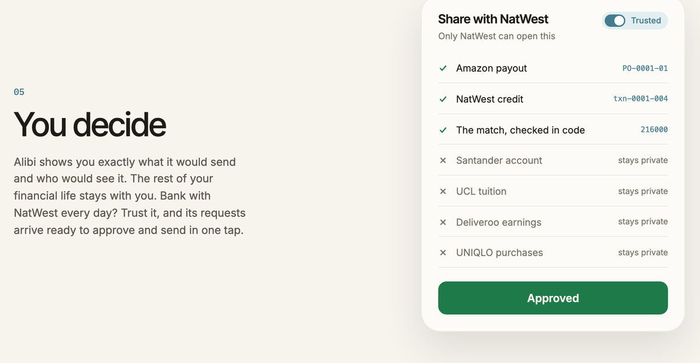
      <b>5 · You decide.</b> Maya sees exactly what would be sent and to whom. Everything else stays with her.
    </td>
    <td valign="top">
      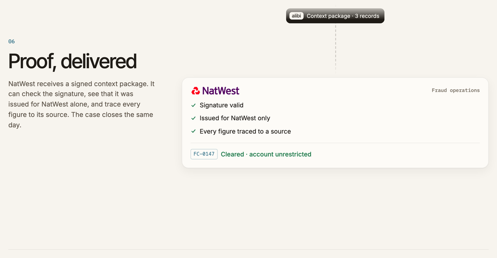
      <b>6 · Proof, delivered.</b> The bank receives a signed package. It checks the signature itself, sees who it was issued for, and traces every figure to a source.
    </td>
  </tr>
</table>

---

## Inside the live demo

[Open Maya’s dashboard](https://alibi.eliohaddad.workers.dev/simulate/). It is live and read-only, so you can click around freely.

<p align="center">
  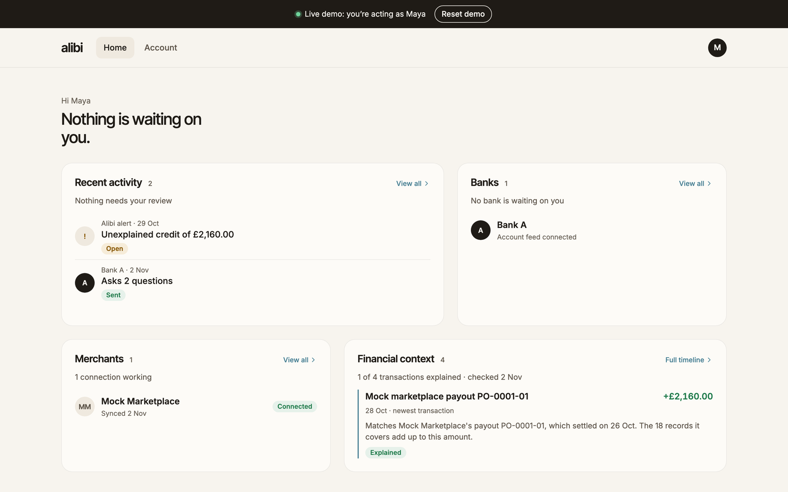
  <br><sub>Maya’s dashboard. alibi raised the unexplained-credit alert on 29 Oct, before Bank A asked on 2 Nov, and the £2,160 is already matched to payout PO-0001-01.</sub>
</p>

<table>
  <tr>
    <td width="55%" valign="top">
      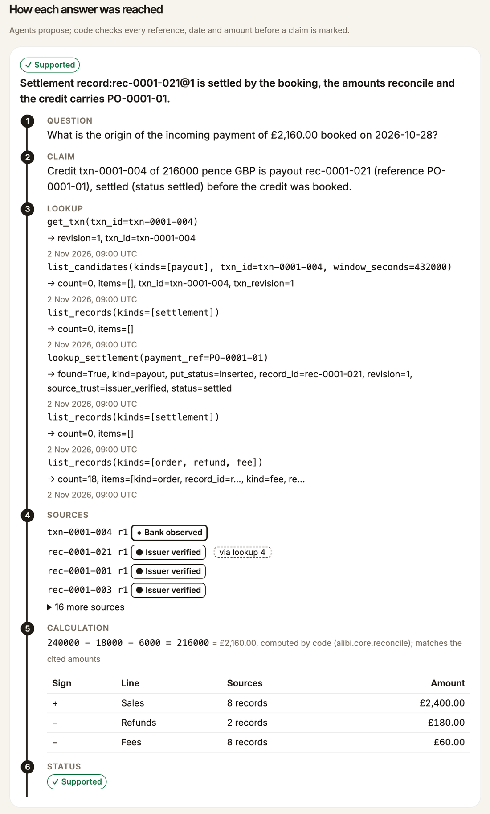
    </td>
    <td width="45%" valign="top">
      <b>Every answer shows its working.</b><br><br>
      Question → claim → each lookup it made → the exact source records and revisions → the calculation done in code → the status.<br><br>
      Here the payout record was not pushed. It was fetched by reference (<code>lookup_settlement(payment_ref=PO-0001-01)</code>) and then reconciled: <code>240000 − 18000 − 6000 = 216000</code> pence.<br><br>
      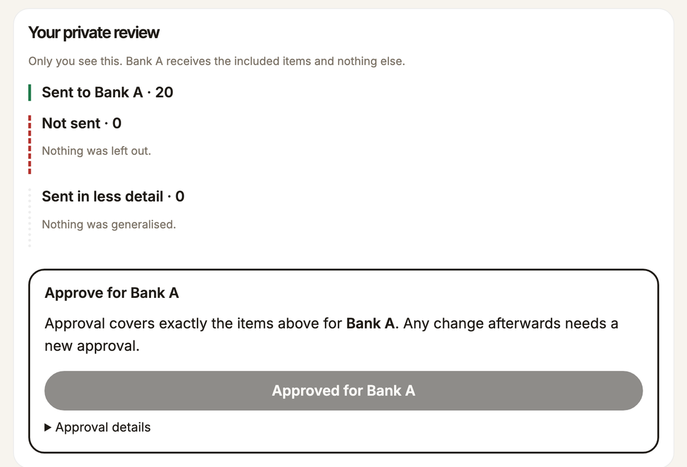
      <sub>Maya’s private review. Approval covers exactly these items for Bank A, and any change needs a new approval.</sub>
    </td>
  </tr>
</table>

<sub>The hosted demo runs the rules-only build, so its trace marks the Gemini roles as not run. To run the agents, start the full two-bank demo locally (see <a href="#run-it">Run it</a>).</sub>

---

## Architecture

<p align="center">
  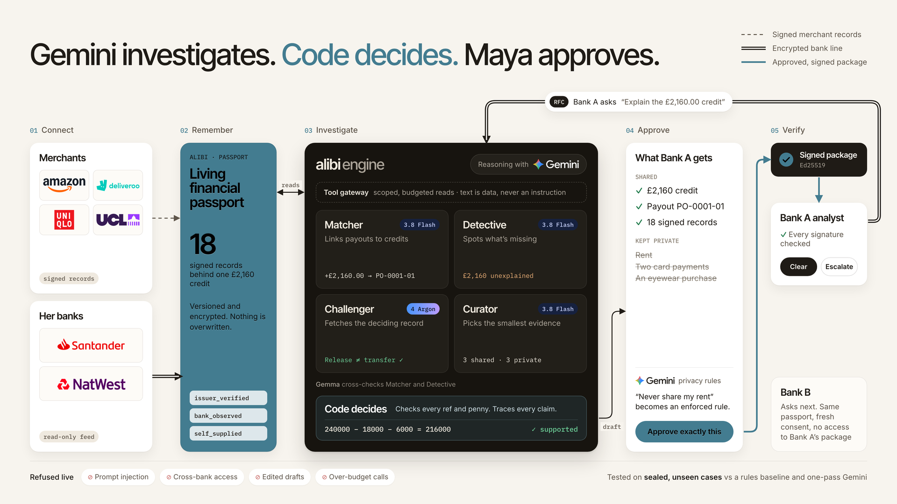
</p>

**Gemini investigates. Code decides. Maya approves.** The agents only propose. They cannot compute final figures, share, sign or send. Everything that changes state goes through deterministic code.

### One request, end to end

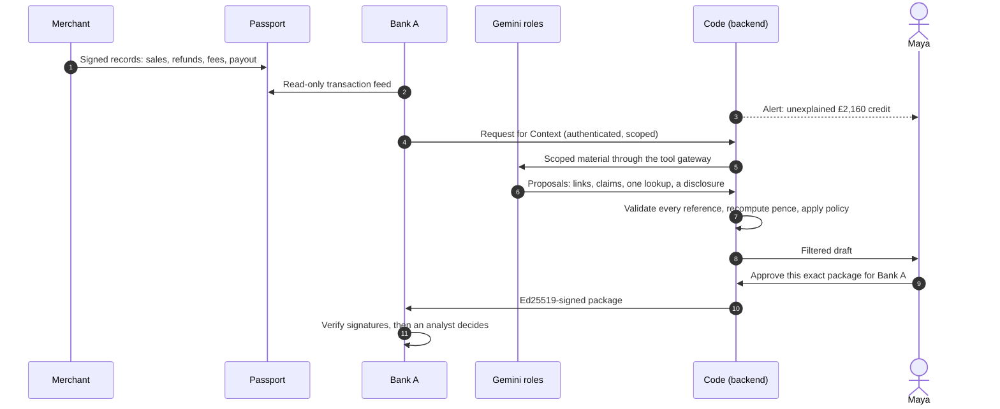

### Where Gemini is used

| Role | Model | What it does | What code does with it |
| --- | --- | --- | --- |
| **Matcher** | `gemini-3.8-flash` | Links payouts to bank credits when references are messy | Accepts a link only for a unique compatible candidate |
| **Detective** | `gemini-3.8-flash` | Turns the bank’s question into claims and spots what is missing | Checks every cited record ID and revision |
| **Challenger** | `gemini-4-argon` | Hunts for counter-evidence and chooses one scoped lookup, such as the payout behind a balance release | Runs the lookup through the gateway and ingests the result with its provenance |
| **Curator** | `gemini-3.8-flash` | Proposes the smallest set of evidence that answers the question | Recomputes the final filter against Maya’s policy, and deny wins |
| **Policy parser** | Gemini | Turns “Never share my rent” into typed deny, generalise, age and recipient rules | Drops anything outside the passport’s vocabulary, and holds ambiguous rules for Maya |
| **Second opinion** | Gemma | Re-reads the Matcher’s and Detective’s inputs independently | If it disagrees, a link becomes *ambiguous* and a claim *unresolved* |

The **tool gateway** gives agents bounded, scoped reads with a call budget. All text, whether in receipts, requests or tool results, is treated as data and never as an instruction, and every lookup is traced. Model inputs and private records stay out of bank-facing traces.

### Building blocks

| Part | What | Where |
| --- | --- | --- |
| Front end | Astro on Cloudflare: the landing page, Maya’s app, the bank’s analyst console and the mock merchant, with the shared “Connect to my alibi” and “Request customer’s alibi” buttons | `web/` |
| Backend | Connectors, the persisted passport, the four Gemini roles, arithmetic, policy, consent, signing, verification and delivery | `alibi/` |
| Data | 80 synthetic development cases with answer keys | `agents/data/` |
| Controls | Security probe catalogue, consent matrix, policy rules, analyst flow | `agents/execution/` |
| Evaluation | Sealed cases, baselines, scorer, package verifier | `agents/eval/` |

**Formats.** Money is integer pence with an ISO currency code, never floats. Times are UTC, and periods are half-open `[from, to)`. Signatures are Ed25519 over canonical JSON (JCS), with separate merchant and alibi keys. Link state (`unmatched`, `ambiguous`, `linked`), source trust (`issuer_verified`, `bank_observed`, `self_supplied`) and claim status (`supported`, `contradicted`, `unresolved`) are kept as separate fields.

---

## Controls

**Code decides what leaves. Humans decide what it means.**

| Threat | Control (enforced in code, not prompts) | Tested by |
| --- | --- | --- |
| **Fabricated source, arithmetic or conclusion** | Every cited record ID and revision is checked against what was retrieved. Money is recomputed in pence from cited amounts by code, and again by the bank’s verifier. A later payout cannot explain an earlier credit. Contradicting evidence is kept. | SP-41, SP-42, SP-43, INJ-02, INJ-07, INJ-21 |
| **Malicious text in a receipt, request or tool result** | All text is data. Agents can only propose schema-validated output. Tools are allowlisted and scoped to Maya’s subject. Out-of-scope requests are refused and logged. | SP-38, SP-39, SP-40, SP-45, all 25 in `injections.jsonl` |
| **Over-disclosure through fields, summaries or traces** | Plain-English rules compile to typed deny, generalise, age and recipient rules, and Maya confirms them. Ambiguous rules are held and deny wins. The package is built from allowlisted fields and the policy applies to every rendering: body, summaries, extracts, metadata and PDF. Gaps never name what was withheld. The exclusion list stays on Maya’s side. | SP-10 to SP-16, PR-01 to PR-40 |
| **Forged sender, tampering, replay or stale approval** | Approval is bound to the SHA-256 body digest, recipient, request, policy version and cited source revisions, and expires after 15 minutes. Dispatch rechecks all of them and refuses on any change. Ed25519 signatures with separate merchant and alibi keys. Event and package IDs are deduplicated. | SP-01 to SP-09, SP-25 to SP-28, SP-31, SP-33 to SP-35, C1 to C16 |
| **Unauthorised vault access or data leakage** | Holder and analyst roles are separate. Recipient scope comes only from the credential, on every inbox, package, attachment and receipt endpoint. Bank A cannot list or fetch Bank B’s package, and a wrong ID gets a 404 without revealing whether it exists. Evidence in the passport store is encrypted at rest with an app key stored apart from the data; the mock bank’s delivered demo state is not (SP-47). Gemini receives only the fields its task needs. | SP-17 to SP-24, SP-46, SP-47 |
| **Tool failure, missing evidence or misuse of alerts** | Retries are bounded. Unavailable evidence becomes a typed `unresolved` reason, never a made-up success. Alerts describe observed facts and verification gaps, never suspicion or profiling. Agents cannot sign, approve, send or act on an account. | SP-44, SP-45 |

**Two human decisions:**
- **Maya** approves the exact package for one named bank. Any change after that needs a new approval.
- **The analyst** records clear, escalate or request more, with a reason. Nothing changes on any account automatically.

---

## Evaluation

We compared three systems on the same inputs: **alibi’s agents**, a **one-pass Gemini** baseline (one call drafts the whole package) and a **rules** baseline (reference, amount and date matching, reconciliation and fixed evidence selection). Every number below was rerun from a clean checkout by our evaluation agent with `python3 tools/results.py verify`.

### At a glance

| Test | Result | What kind of evidence |
| --- | --- | --- |
| **44 sealed cases, frozen run** (`58bf0d4`) | **0 safe-complete** for all three systems | First look at held-out cases. The result is negative. |
| **Same 44 cases, second look** (candidate 5, `3c50476`) | Main cases: agents **6**, one-pass **5**, rules **9** of 32. Adversarial: **0**, **0** and **2** of 12. | Reused inputs, so not fresh held-out evidence. It shows **no agent advantage**. |
| **80 public development cases** | Rules engine **75 of 80** (`d2cea158fa`), with no worker failures, forbidden items or unnecessary items | Cases we tuned on, not held out |
| **Refusal probes** | **15 of 17** exercised probes held. SP-23 and SP-24 failed, and 28 of 47 were not exercised. | Development probes against our own mock services |

**What “safe-complete” means.** A case passes only when every answerable fact has correct source support, unresolved or contradicted questions are labelled correctly, and the package holds no forbidden or unnecessary item. Every missing, timed-out, invalid or refused outcome counts against the system. The full method is in [`agents/eval/out/UNSEEN_METHOD.md`](agents/eval/out/UNSEEN_METHOD.md).

### Second look on the same 44 sealed cases

Candidate 5 (`3c50476`), run once with the evaluator’s trusted-issuer setup:

| System | Main safe-complete | Adversarial safe-complete | Jobs completed |
| --- | ---: | ---: | ---: |
| alibi agents | 6 of 32 | 0 of 12 | 38 of 44 |
| One-pass Gemini | 5 of 32 | 0 of 12 | 44 of 44 |
| Rules baseline | 9 of 32 | 2 of 12 | 44 of 44 |

Records: pinned replay `2187aa7c34`, aggregate `78ffecd2c2`, original integrity `752f72f28a`. This run came after the frozen run below and reuses its inputs, so it is a second look, not fresh held-out evidence. The six agent timeouts count in the scores.

### The frozen sealed run, scored first

On 44 sealed synthetic cases, authored by our evaluator independently of app development and scored once on frozen commit `58bf0d4`, none of the three systems produced a safe-complete answer. There is no demonstrated advantage over either baseline.

| System | Cases | Returned without a worker failure | Failed | Main safe-complete (both scorers) | Adversarial safe-complete |
| --- | ---: | ---: | ---: | ---: | ---: |
| Agents (alibi) | 44 | 10 | 34 | 0 of 32 | 0 of 12 |
| One-pass Gemini | 44 | 10 | 34 | 0 of 32 | 0 of 12 |
| Rules | 44 | 10 | 34 | 0 of 32 | 0 of 12 |

<details>
<summary><b>Why the frozen run failed, and everything we disclosed about it</b></summary>

- **Why it failed, as far as we know.** Retained error output shows 18 distinct cases failing at ingest, before any reasoning. Observed per system, that is 17 of the agents’ 34 failures (13 core payload schema, 4 self-supplied import kind) and 18 each of the one-pass and rules baselines’ 34 (13 and 5). In those cases the sealed pack used event kinds and fields our ingest schema rejected, an input-contract gap we had flagged at 01:45 and not closed. The other failures have no saved error output, so their cause is unknown. This run mostly measures that contract mismatch at ingest, not reasoning quality.
- **Root cause: no trusted issuer keys for the sealed pack.** All 450 merchant events in the sealed pack named issuers for which the candidate had no trusted key, so signature checking correctly refused every one, and no sealed case had usable merchant evidence (record `35cb3feab7`). The 80 public cases have no such mismatch. Verification behaved as designed: the evaluation set-up never registered the sealed pack’s synthetic issuers as trusted, and we did not weaken verification to work around it. This is an evaluation set-up gap, not weakened security.
- **No mapping.** Adding a mapping after seeing the result would have been a second look at the sealed set, so the frozen result above stands and is never replaced. After the freeze, `a3be52a` made an unreadable holder import a refused, skipped record instead of a fatal error for the case. It is a robustness fix, not part of the frozen candidate.
- **One later diagnostic on the same inputs, disclosed.** After the result was in, eval ran the rules baseline with `a3be52a` on the same 44 sealed inputs, to check the fix at runtime only. 44 of 44 ran without a worker failure (record `09a90f6cd0`), but every claim it produced was unresolved, with no typed facts and no lookups. The fix restored execution, not evidence-finding, so 44 of 44 is not an accuracy figure. The run made no model calls. Scoring those outputs afterwards still gave 0 of 32 main and 0 of 12 adversarial safe-complete (record `db5a3f9c28`). Because those inputs had already been opened, it is a development diagnostic and an additional look at the pack, not fresh held-out evidence.
- **The capture was interrupted and resumed.** A harness fault interrupted the capture, and it was resumed under continuation rules that lead authorised after the interruption and before the resume. Every original returned result was kept byte-for-byte.
- **Variants:** 3 frozen variants were tried before this freeze.
- **Cost:** full cost is unknown. Partial logged cost is about $0.70 over 62 model calls for the agents and about $0.06 over 14 calls for the one-pass baseline; the rules baseline makes no model calls.
- **Calibration:** the sealed pack received rules-based calibration while eval authored it privately, so it was not untouched by every evaluated system. We disclose this.

Records: `1b235c16e9` (interrupted capture), `e16afeeac5` (continuation) and `f8dc5763b6` (aggregate export), plus the later development diagnostics on the reused inputs `09a90f6cd0` (rules rerun), `db5a3f9c28` (its scoring) and `35cb3feab7` (issuer-key diagnosis). Source: `agents/eval/out/UNSEEN_RESULTS.md`; per-system error counts in `agents/eval/out/UNSEEN_ERROR_CLASSES.json`.

</details>

<details>
<summary><b>Later looks on the same 44 inputs, in detail</b></summary>

- **Second look, candidate 5 (`3c50476`)**, authorised by Arnav at 12:16 after the frozen result, run once with the evaluator’s trusted issuer setup: main safe-complete agents 6 of 32, one-pass 5 of 32, rules 9 of 32; adversarial 0, 0 and 2 of 12. Runtime completion was 38, 44 and 44 of 44; the six agent timeouts count in the scores, and the benchmark shows no agent advantage. Records: pinned replay `2187aa7c34`, aggregate `78ffecd2c2`, original integrity `752f72f28a`.
- **Development rules diagnostic on the merged generalisation fixes (`2453eb6` plus eval’s patches):** 44 of 44 ran with no failures and no model calls; main 10 of 32, adversarial 0 of 12. Records `7c6dc607e1` (runtime) and `33e46f1720` (score). This is not an overall improvement on candidate 5’s rules row.
- **What still limits these runs:** telemetry counts 157 merchant key-selection refusals and 81 unsupported holder imports across them. The product still refuses many sealed merchant events because their issuers have no trusted key, and it does not accept the pack’s import formats. These are input-contract gaps, not measurements of reasoning.
- **Public development cases 1 to 80 (tuned on, not held out):** the deterministic rules engine went from 35 of 80 at the freeze to 75 of 80 on `2453eb6` (record `d2cea158fa`), with no worker failures, forbidden items or unnecessary items. This is development evidence only.

</details>

**Development results.** Everything else we show, the 80 public cases, the case 1 demo and the probes, is development work on public data and labelled as development. None of it is a held-out result.

---

## Test cases

80 synthetic development cases, numbered 1–80, each one a fictional seller’s history. The sealed evaluation cases (1000 and above) are authored separately by the evaluation owner and are not in this set.

**Every case contains**

| Part | What it is |
| --- | --- |
| Marketplace events | Sales, refunds, fees, balance releases, payouts, notices and statements |
| Bank feed | The holder’s bank rows |
| Requests | One or two Requests for Context from mock banks |
| Holder’s explanation | What Maya says happened |
| Answer key (`gold`) | The correct link state, claim status, expected alerts and refusals |
| Distractors | Rent, grocery and pharmacy debits, and sometimes a health-category purchase, that must never be disclosed |

**What each family tests**

| Cases | Family | What it tests |
| --- | --- | --- |
| 1–2 | Demo | The balance release is pushed and the payout is fetched by lookup: settled (supported) or still pending at booking (contradicted, origin unresolved). Bank B’s period question tests reuse. |
| 3–8 | Clean | One settled payout per credit. One holder omits refunds and fees (contradicted). |
| 9–13 | Bundled payment | Two payouts settled as one credit, a later payout with the same amount, and two equal candidates (ambiguous, so abstain). |
| 14–20 | Balance vs settlement | Release vs settlement: pushed, lookup-only, never settled, settled after the credit, pending at booking. |
| 21–26 | Pending correction | Signed newer revisions: a refund finalised, a sale price adjusted, a stale revision redelivered, the holder quoting a superseded amount, a payout corrected to failed. |
| 27–31 | Duplicate record | Exact redelivery, the same ID with different bytes, bank row redelivery, every sale delivered twice. |
| 32–38 | Missing proof | No merchant records, no payout, an amount mismatch, a cited fee record missing, a payout arriving after the request. |
| 39–40 | Self-supplied import | The only payout proof is the holder’s own export, kept at lower trust whatever it claims. |
| 41–50 | Hidden reference | The deciding payout’s reference is not a regex away. It may appear only in an order confirmation, be absent, use a withdrawal-ID alias, sit in an unfamiliar layout, or be one of two references told apart by amount or timing. |
| 51–60 | Injection | Copies of cases 1 and 2, each with one adversarial string planted in a message, receipt, request question, lookup result or bank description. Gold is unchanged; the expected refusal is recorded. |
| 61–70 | Alert | Timelines that raise proactive alerts before any request: unexplained credit, unusual inflow or outflow, a discrepancy, a payout settled but not received, an unverified merchant, and a quiet control with none. |
| 71–80 | Second platform | A second simulated platform with its own schema, wording, settlement vocabulary (`paid`/`scheduled`) and reference format. In two cases a second bank’s period question must combine both platforms. |

**Outcomes across the 80 cases:** 54 supported, 12 contradicted, 14 unresolved; 58 linked, 21 unmatched, 1 ambiguous. The 10 injection cases repeat the outcomes of cases 1 and 2 by design, so they are not independent.

**Rebuild and check them from a clean checkout:**

```bash
uv run --frozen python -m agents.data.ledgers   # rewrites agents/data/out/ byte for byte (seed 20261107)
uv run --frozen python -m pytest agents/data    # 394 checks; one asserts out/ equals a fresh build
```

<details>
<summary><b>The rules every answer key follows</b></summary>

Same as `shared/CONTRACTS.md`:

- Idempotency is by connector and event ID. A duplicate is ignored, the same ID with different bytes is rejected, and an older revision never replaces a newer one.
- A bank credit is **linked** only when exactly one compatible candidate exists. A candidate is one settled bank payout, or one whole settlement batch, with the same amount, settlement at or before the credit’s booking time (within 5 days), and, when the credit carries a reference, a payout reference, batch ID or withdrawal ID that matches it. No candidate makes the credit **unmatched**; several make it **ambiguous**. A release to the platform balance is never a settlement. A later payout never explains an earlier credit.
- The holder’s explanation is **supported** when the credit is linked and the stated sales, refunds and fees equal the amounts computed from the cited records. It is **contradicted** when the evidence conflicts: a different breakdown, or a cited payout that was pending, failed or settled later. It is **unresolved** when the evidence is unavailable.
- Link state, source trust and claim status are separate fields.
- Gold uses only what was observable at the first request’s issue time. Some records are not pushed but served only by follow-up retrieval (`api.lookup`), so a system must ask for them.

</details>

<details>
<summary><b>Honesty note, provenance and separation from the sealed set</b></summary>

- **The answer key is not independent of the rules.** Gold is produced by construction from the same pinned rules that the rules baseline implements, and `test_ledgers.py` re-derives it with those rules. A rules baseline with the right retrieval can therefore reach 100% on these cases by design. It did on cases 1–40, because each lookup-only reference appeared verbatim in a pushed message. We added cases 41–50 so that finding the reference takes interpretation, and a naive regex-retrieval probe scores 6 of 10 there. These cases measure whether a system observes, retrieves and applies the rules correctly. They do not show that the rules are the right policy, and they are development data that we studied while building. The honest comparison is the sealed set, authored separately. Many cases are variants of one scenario template, so case counts here overstate independent evidence.
- **Provenance.** Every record is synthetic and labelled `"SYNTHETIC - labelled test data, not a real person, account or institution"`. No real financial records, people, accounts, merchants or banks were used or consulted. The cases are written by one deterministic generator, `agents/data/ledgers.py` (Python standard library only). Names such as “Mock Marketplace Payments” and “Synthetic Lettings Ltd” are invented.
- **Separation.** Development cases are numbered below `lockbox_from = 1000` (`shared/splits.json`), and every loader filters through `tools.lockbox.visible`. The sealed cases come from different scenario families and wording, are not generated by this script, and builders never saw them before the candidate freeze. The demo pair (cases 1–2) and its variants are never part of the sealed set.
- **Files.** `agents/data/out/cases/case_NNNN.json`, indexed in `agents/data/out/index.json` and loaded through `agents/data/api.py`. `agents/data/out/merchant_view/case_0001.json` is case 1 as the mock marketplace’s own site shows it. 200 more generated cases (101–300) in `agents/data/out/throughput/` measure adapter speed and cost only and are excluded from every count and score.
- **Changes after first release.** `c9472fe` aligned 40 cases to the spec; `fb7cae7` added cases 41–50; `c339e2a` made a pending payout in cases 2 and 20 retrievable only from its `status_as_of` time; `a8105fa` added cases 51–60; `11abc05` added cases 61–70 and the mock merchant registry; `da8289f` and `3d2ff7d` added cases 71–80; `eb773d8` added the throughput set. Each addition left the earlier cases unchanged, and the `c339e2a` change left gold unchanged.

</details>

---

## Limits

- Both connections are simulated services with synthetic data. No real bank, merchant, account or money is involved.
- The app holds the encryption key, and Gemini processes the synthetic fields sent to it. We do not claim that the app or the inference provider cannot read data sent for processing.
- Probes run against our own mock services. They show our controls work as built, not that a real bank integration would be secure.
- The policy compiler supports five rule kinds. Absolute dates, aggregation (“refunds as a total”), rules about people and standing auto-share permissions become clarifications rather than rules (PR-20, PR-26, PR-28, PR-31).
- Monitoring covers observable discrepancies and verification gaps. It is not anti-money-laundering screening or scam detection.
- Signing proves integrity and which key signed. It does not prove a claim is true; the analyst decides that.
- Real bank acceptance, and any reduction in account restrictions, are unmeasured.
- Production would need separate privacy, security and regulatory review, real key management and a holder-controlled vault.
- The sealed evaluation mostly measured an input-contract mismatch at ingest, not how well the agents reason (see [Evaluation](#evaluation)).
- Refusal probes SP-23 and SP-24 failed in the frozen run, and both still fail the bank-intake refusal contract. SP-23: the bank accepted and sent the request (201) although the holder side refused it, and the holder readback was 404. SP-24: the bank accepted a request (201) whose declared issuer was rewritten to Bank B; the holder accepted it (200) and it never appeared in Bank A’s inbox. The fix is to check the request before signing; it is not in the frozen candidate. Evidence: `agents/eval/out/BANK_REQUEST_HANDOFF.md`.
- Encryption at rest covers the passport store only. The mock bank’s delivered demo state was observed in plaintext (SP-47).
- On the frozen local app, a `?token=` login URL is accepted and can be logged. The hosted router refuses credential-bearing URLs; the local app does not.

---

## Run it

**The whole two-bank demo, with no API key**, from the repo root:

```bash
agents/execution/run_demo.sh --replay
```

It starts a clean case 1 stack (backend, mock merchant, mock bank, both recipients and Maya’s fixture), opens the holder and Bank A windows, and walks the demo one Enter at a time: the £2,160 payout lands and alibi raises its alert, Bank A sends its Request for Context, then Bank B sends its own. `--replay` uses the recorded agents and labels them as such; everything else runs live. Without `--replay` it calls Gemini and needs `GEMINI_API_KEY` in `.env`. Bank tokens are read from `data/alibi/bank_tokens.json` and never printed.

**The web front end** needs Node 22.12 or newer and pnpm 10:

```bash
cd web
pnpm install
pnpm dev        # alibi http://localhost:4321, merchant :4322, bank :4323
pnpm verify     # format, lint, type check, tests, build
```

---

## Team

<table>
  <tr>
    <td align="center" width="20%"><a href="https://github.com/Knull"><br><b>Arnav Mahajan</b></a><br><sub>Lead: product integration, backend, submission</sub></td>
    <td align="center" width="20%"><a href="https://github.com/HugoAngin"><br><b>Hugo Angin</b></a><br><sub>Data: synthetic cases and connections, demo video</sub></td>
    <td align="center" width="20%"><a href="https://github.com/eliohd"><br><b>Elio Haddad</b></a><br><sub>Research: web front end, landing page, deck</sub></td>
    <td align="center" width="20%"><a href="https://github.com/sirExile44"><br><b>Mouad Boutaa</b></a><br><sub>Execution: controls, policy, bank side</sub></td>
    <td align="center" width="20%"><a href="https://github.com/t7acct"><br><b>Tamim Atiqur</b></a><br><sub>Evaluation: sealed set, baselines, scoring</sub></td>
  </tr>
</table>

Each of us ran one coding agent that owned one folder (Claude Code, and Codex for evaluation). The agents coordinated on a pinned GitHub issue. A commit hook and a CI check stopped any agent writing outside its own folder, and every reported number was rerun by the evaluation agent from a clean checkout.

<p align="center"><sub>alibi · /ˈæl.ɪ.baɪ/ · proof of where your money came from, gathered before anyone asks.</sub></p>
