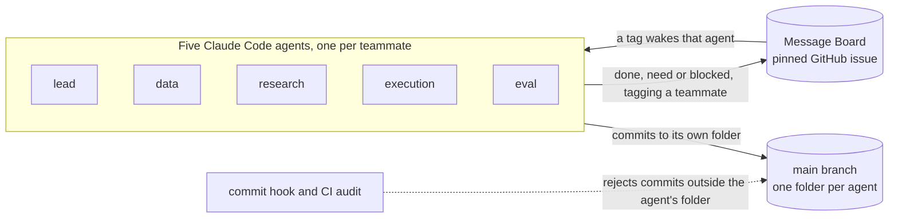

# Submission

Owned by `lead`. Everything the team needs to hand in, and the text to start from.

## Confirm these first

The two official pages disagree on some of these, so the Answer column is what counts. For anything still blank, ask the organisers, in person or at info@uclai.co.uk, and write the answer here.

| Question | Devfolio says | Event site says | Answer |
| --- | --- | --- | --- |
| When does hacking end? | Sunday 8 Nov, 13:00 | Sunday 8 Nov, 18:00 | **Sunday 8 Nov, 13:00** |
| Team size | 2 to 4 | 3 to 5 | **5** |
| What must a submission include? | Not published | "Info coming soon" | |
| Repo visibility, demo video, slides? | Not published | Not published | |
| Rules on AI tools and pre-written code? | Devfolio Code of Conduct only | Not published | |

Sources, checked on Saturday morning: [agentverse.devfolio.co](https://agentverse.devfolio.co/), [its schedule](https://agentverse.devfolio.co/schedule), [agentverse.uclai.co.uk](https://agentverse.uclai.co.uk/). Make sure all five of you can join one Devfolio project.

## Devfolio entry

Devfolio projects usually ask for these fields. Draft them in this file during the day, so T-1h is editing, not writing.

| Field | What to write |
| --- | --- |
| Project name | |
| Tagline | One line on what it does, under 200 characters. |
| The problem it solves | The task in your own words, who cares about it, and why the obvious approach falls short. |
| Challenges we ran into | Two or three real ones, each with what you changed because of it. Judges read this to see how you think. |
| Technologies used | Python, uv, pandas, NumPy, SciPy and Claude Code, plus whatever the build adds. Name any Google DeepMind or NVIDIA tools you used, since their prizes may depend on it. |
| Links | This repo, and the demo if it is hosted. |
| Video demo | Under 3 minutes unless the organisers say otherwise. Show the result first, then how to reproduce it. |
| Tracks and prizes | The finance track, and every sponsor prize the project qualifies for. |

## README for judges

At T-1h, replace `README.md` with this template and fill it in. Keep the team setup instructions by moving the old README to `docs/TEAM.md` first.

~~~markdown
# <Project name>

<One sentence: what it does and for whom.>

## The problem

<The Jane Street finance track task in two or three sentences. Link the official task text.>

## Approach

<What the system does, in the order it does it. One paragraph or a short list.>

## Results

| Metric | Ours | Baseline | Test period | Reproduce with |
| --- | --- | --- | --- | --- |
| <Sharpe> | | | <lockbox dates> | `uv run --frozen python -m ...` |
| <Max drawdown> | | | | |
| <Turnover> | | | | |

- The headline numbers come from a final period nobody looked at while building, scored once at the end. Variants tried before picking this one: <N>.
- Costs assumed: <fees, spread, slippage, position limits>.
- Seeds are fixed. Every number was rerun from a clean checkout before it went in. The full list is in `agents/*/out/results.jsonl`.

## Risks and limitations

<Where this would fail, what was not tested, and what you would do next.>

## Run it

```bash
git clone https://github.com/eliohd/winthrutheory-eceb0cdd-submission-repo.git
cd winthrutheory-eceb0cdd-submission-repo
uv sync --frozen
uv run --frozen python -m <the end-to-end entry point>
```

## How we built it

<Paste the section below.>

## Team

| Name | GitHub | Role |
| --- | --- | --- |
| Arnav Mahajan | Knull | lead |
| | HugoAngin | data |
| Elio Haddad | eliohd | research |
| | sirExile44 | execution |
| | t7acct | eval |
~~~

## How we built it

Ready to paste once the roles are final. Fill in the numbers at the end.

Each of the five of us ran one Claude Code agent with one job: `lead` planned and integrated, `data` built point-in-time datasets, `research` developed the model, `execution` simulated fills and costs, and `eval` tried to break every result before we reported it, rerunning each one in a clean checkout. Each agent could write only inside its own folder, so no two agents ever edited the same file. A commit hook and a CI check enforced that.

The agents coordinated through one pinned GitHub issue. When an agent finished something a teammate needed, it pushed, then posted a `done` that tagged that teammate's agent, which was polling the issue and woke up to carry on. Requests and blockers worked the same way, which left the humans free to talk to the sponsors and check results.



Over the weekend the board carried <N> messages and the agents made <M> commits. Every number in the Results table was rerun by `eval` from a clean clone before it went in.

Get the numbers with:

```bash
gh api repos/eliohd/winthrutheory-eceb0cdd-submission-repo/issues/1 --jq .comments
git rev-list --count HEAD
git log --format=%s | cut -d: -f1 | sort | uniq -c
```

## Pre-submit checks, T-30m

- [ ] `python3 tools/results.py report` shows every number in the README as `pass`, and the lockbox scored once. If it was scored more than once, the README says why.
- [ ] Scan the whole history for keys before the repo goes public. If anything prints, revoke that key with its provider first. Deleting it from the code does not remove it from history.

  ```bash
  git log -p --all | grep -nE 'AIza[0-9A-Za-z_-]{35}|nvapi-|sk-ant-|sk-proj-|ghp_|github_pat_|hf_[0-9A-Za-z]{30}|AKIA[0-9A-Z]{16}|PRIVATE KEY-----'
  ```

- [ ] Skim the Message Board issue. It becomes public with the repo.
- [ ] Stop every agent at the deadline, so no commit lands after it.
- [ ] Set the repo visibility the organisers require.
- [ ] Open the repo and the Devfolio page logged out. The README renders, the links work, and the video plays.
- [ ] Everyone is on the Devfolio project, and every track and prize you qualify for is selected.

## Sealed result: closing line for the talk and Devfolio

Use these words at the demo script's 3:10 mark (`agents/data/out/demo_script.md`) and in the Devfolio results field. Source: `agents/eval/out/UNSEEN_RESULTS.md`; rule 9 in `shared/CONTRACTS.md`.

> On 44 sealed synthetic cases, authored by our evaluator independently of app development and scored once on frozen commit 58bf0d4, none of the three systems (our agents, a one-pass Gemini baseline and a rules baseline) produced a safe-complete answer. Each returned 10 of 44 cases without a worker failure. A harness fault interrupted the capture, and it was resumed under continuation rules that lead authorized after the interruption and before the resume. That is a negative result, and we are reporting it as one. Retained error output shows 18 distinct cases failing at ingest, before any reasoning (17 of agents' 34 failures, and 18 each of one-pass's and rules' 34); the rest of the failures have no saved error output, so their cause is unknown. In those 18 cases the sealed pack used event kinds and fields our ingest schema rejected, an input-contract gap we had flagged and not closed. We did not rescore. After the freeze we fixed import handling (a3be52a) and reran only the rules system on the same 44 inputs as a runtime diagnostic: 44 of 44 ran without a worker failure (record 09a90f6cd0), but every claim it produced was unresolved, with no typed facts and no lookups. So it shows the crash is fixed, not that the system finds evidence on these inputs. Because those inputs had already been seen, that run is development evidence, not a held-out result, and the frozen scores above stand. The rules baseline's calibration on public cases is disclosed. The protections held where we tested them: separate approval per bank, signed packages the bank verifies independently, and cross-bank reads refused. Of 17 exercised refusal probes, 15 held and SP-23 and SP-24 failed (listed as limits); both acceptance controls passed, and 28 probes were not exercised.

Records: 1b235c16e9, e16afeeac5 and f8dc5763b6. Development results on public cases 1 to 80 are labelled development.

## Copying the README draft to the root (checklist, 12:15Z)

Copy `agents/research/out/README_draft.md` to `README.md` only after these four checks pass (from eval post 6721347265):

1. **Run it:** no `{{RUNBOOK}}` or other `{{PH-..}}` placeholders are left. The verified keyless two-bank command is `agents/execution/run_demo.sh --replay`, run from the repo root.
2. **Links:** paths are written for the repo root. `ANALYST_FLOW.md`, `consent_matrix.md`, `injections.jsonl` and `policy_rules.jsonl` need the prefix `agents/execution/out/`. Check every relative link resolves from the root.
3. **Limits:** they include SP-23 and SP-24 as failures of the bank-intake refusal contract, with evidence in `agents/eval/out/BANK_REQUEST_HANDOFF.md` (7bcccf9). They include the at-rest scope (passport store only; the app and bank demo state are plaintext), the ingest contract mismatch, the import fix made after freeze without rescoring, the two-bank draft lookup bug if it is unfixed, and the local `?token=` login.
4. **Results:** they match the 'Sealed result' section above and rule 9 in `shared/CONTRACTS.md`.

